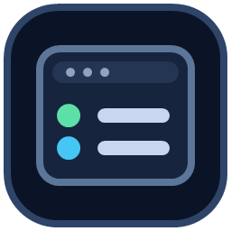

# DevBoard

Tableau de bord Windows pour [Laragon](https://laragon.org) : tout l'environnement de développement local sur un seul écran.

## Télécharger

**[DevBoard.exe](https://github.com/AgimCoding/devboard-/raw/main/DevBoard.exe)** — un seul fichier, aucune installation (Windows 10/11 64 bits, .NET inclus).

Au premier lancement, Windows SmartScreen peut afficher un avertissement car l'exécutable n'est pas signé : « Informations complémentaires » puis « Exécuter quand même ».

## Fonctions

- **Vue d'ensemble** : services actifs, sites, projets, version de PHP active, alertes.
- **Services** : démarrer, redémarrer, arrêter Apache, Nginx, MySQL, Redis, Memcached, Mailpit ; démarrer Laragon ; écarter un autre serveur MySQL qui occupe le port.
- **Ports** : ports TCP en écoute et processus qui les occupent.
- **Sites** : hôtes virtuels croisés avec le disque et le fichier hosts, correction en un clic.
- **Projets** : type, branche et état Git, versions de PHP/Node requises, commandes courantes (composer, npm).
- **Journaux** : suivi en direct, filtre, vidage et archivage.
- **Bases de données** : création, suppression, export, import, tables, et édition des lignes d'une table.
- **Zone de notification** : pastille d'état et alerte quand un service s'arrête.

## Prérequis

Laragon installé. DevBoard le détecte automatiquement ; sinon, indiquez son dossier dans Paramètres.

Les actions qui touchent au système (fichier hosts, services Windows) demandent une autorisation administrateur au moment où vous les lancez.
